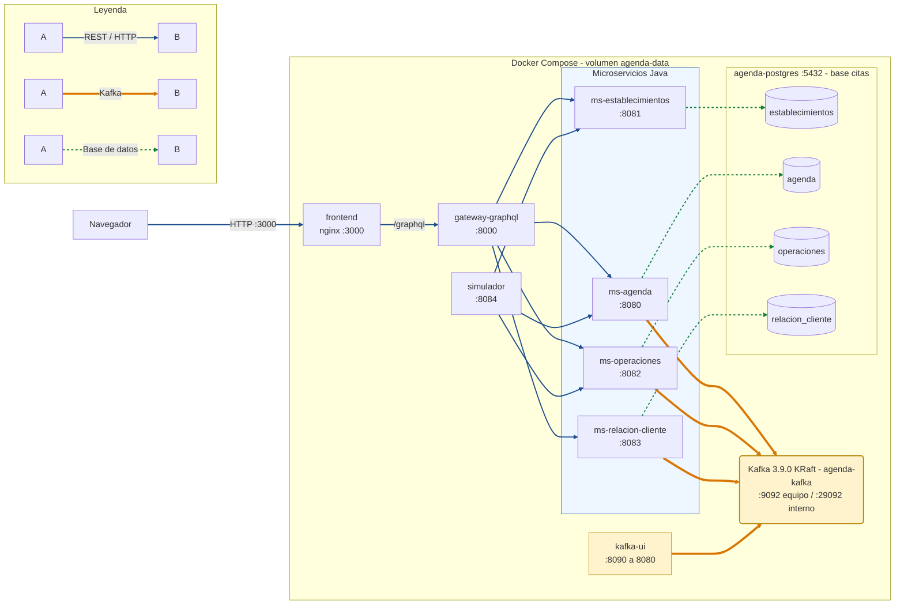
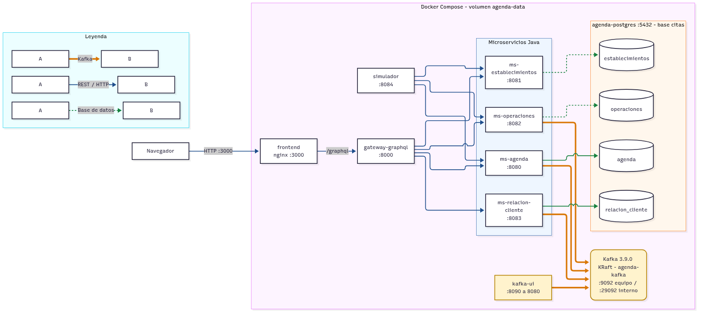

# 1. Arquitectura y despliegue

AGENDAPP - Equipo 5, Grupo 3, Programación Avanzada, FET. Fuente: `docker-compose.yml`, `frontend/nginx.conf`, `db-init/01-esquemas.sql`.

Leyenda: flecha azul continua = REST/HTTP; flecha naranja gruesa = Kafka; flecha verde punteada = base de datos. Kafka se dibuja como rectángulo redondeado.

## Verificado contra

| Elemento | Dónde se comprobó |
|---|---|
| Puertos 3000, 8000, 8080-8084, 8090 (->8080 interno), 5432, 9092 | `ports:` de cada servicio en `docker-compose.yml` |
| Kafka `apache/kafka:3.9.0`, KRaft, listeners 29092 (interno) y 9092 (equipo) | servicio `kafka` en el compose |
| Postgres 16, base `citas`, volumen `agenda-data` | servicio `postgres` y `volumes:` |
| 4 esquemas: establecimientos, agenda, operaciones, relacion_cliente | `db-init/01-esquemas.sql` y `hibernate.default_schema` de cada `application.properties` |
| Esquema propio por servicio (ms-establecimientos, ms-agenda, ms-operaciones, ms-relacion-cliente) | `@Table(schema=...)` de las entidades |
| nginx envía `/graphql` al gateway (`gateway-graphql:8000`) | `frontend/nginx.conf` |
| Gateway llama a los 4 microservicios | `ServiciosInternos.java` y variables `*_URL` del compose |
| Simulador llama a establecimientos, agenda y operaciones | `ApiClient.java` y variables del compose |
| ms-agenda, ms-operaciones y ms-relacion-cliente usan Kafka; ms-establecimientos no | `KAFKA_SERVERS` solo en esos tres servicios |
| kafka-ui se conecta a `kafka:29092` | `KAFKA_CLUSTERS_0_BOOTSTRAPSERVERS` |

Nota: el comentario del compose dice que ms-agenda es el «único productor de eventos», pero ms-operaciones también produce `inventario.insumo-bajo` (`OperacionesService.java`). El diagrama sigue el código. kafka-ui es una herramienta de desarrollo, según el propio compose.
