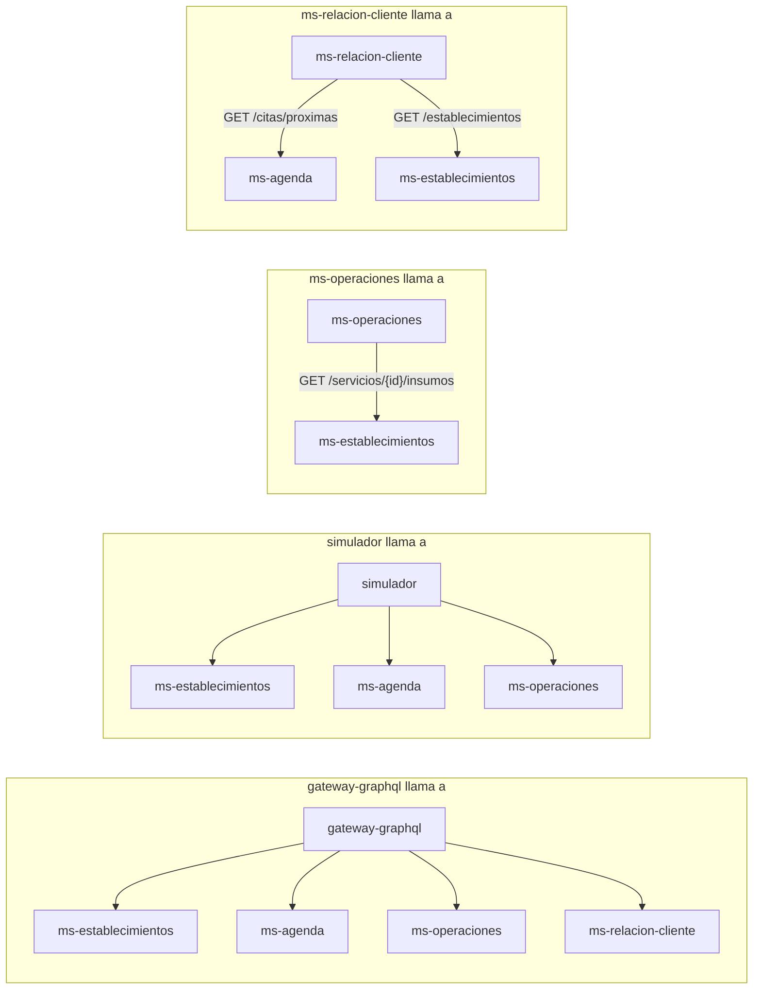
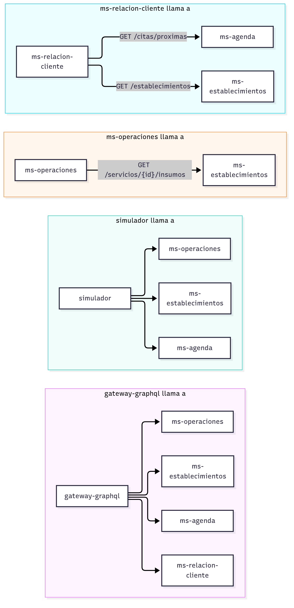
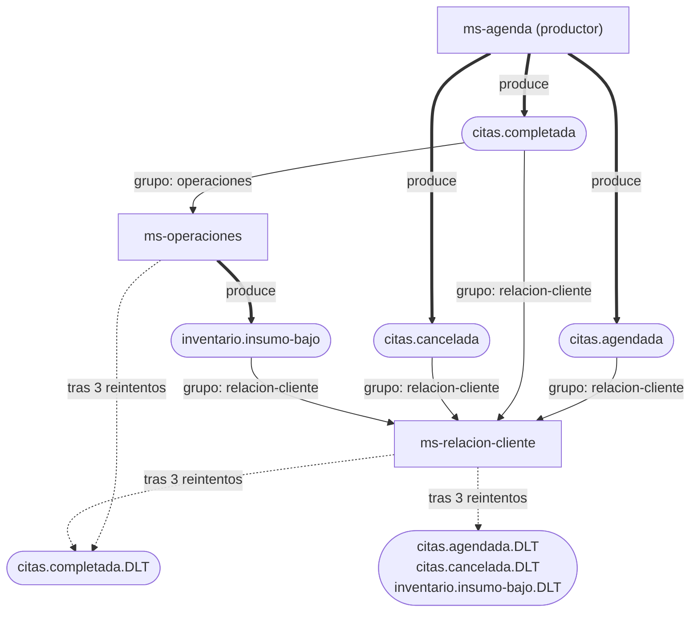
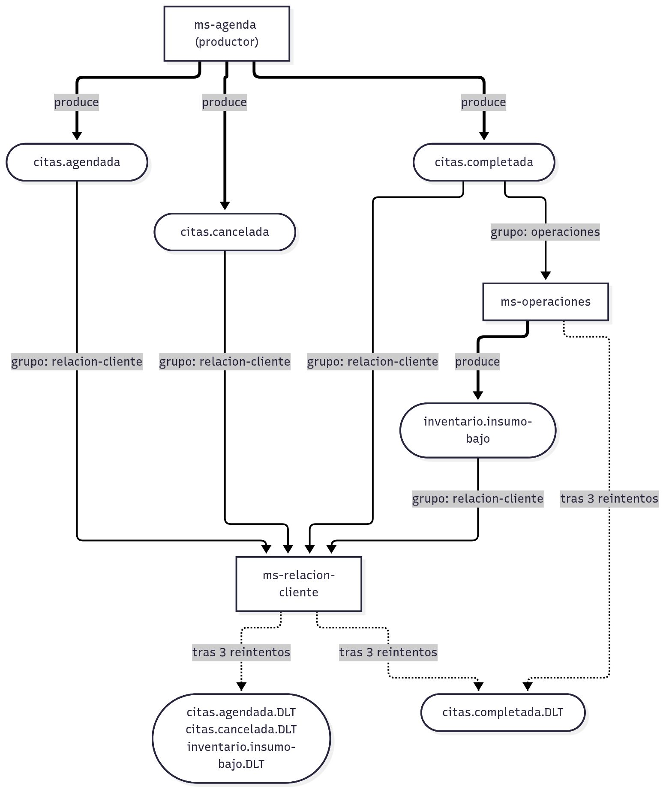

# 2. Comunicación REST y Kafka

## 2a. Llamadas REST entre servicios

## 2b. Topics de Kafka

## Verificado contra

| Elemento | Dónde se comprobó |
|---|---|
| Gateway -> 4 servicios | `ServiciosInternos.java` (`establecimientos`, `agenda`, `operaciones`, `relacion`) y uso en `ConsultasController.java` |
| Simulador -> establecimientos, agenda, operaciones | `ApiClient.java`; `GeneradorDeCitas.java` (agenda), `SemillaDatos.java` (establecimientos, operaciones `/inventario`) |
| ms-operaciones -> `GET /servicios/{id}/insumos` en ms-establecimientos | `CatalogoClient.java` |
| ms-relacion-cliente -> `GET /citas/proximas` (ms-agenda) y `GET /establecimientos` | `AgendaClient.java`, `EstablecimientosClient.java` |
| ms-agenda produce `citas.agendada`, `citas.completada`, `citas.cancelada` | `HechoDeCita.java`, `PublicadorKafka.java` (AFTER_COMMIT) |
| ms-operaciones produce `inventario.insumo-bajo` | `OperacionesService.TOPIC_INSUMO_BAJO` |
| Grupo `operaciones` consume `citas.completada` | `EscuchaCitas.java` |
| Grupo `relacion-cliente` consume los 4 topics | `EscuchaEventos.java` |
| `.DLT`: 3 reintentos cada 2 s y luego `<topic>.DLT` (`DeadLetterPublishingRecoverer`) | `ManejoDeErroresKafka.java` en ms-operaciones y ms-relacion-cliente |

Nota sobre `.DLT`: ambos consumidores usan el nombre por defecto, por lo que un fallo de `citas.completada` en cualquiera de los dos grupos termina en el mismo `citas.completada.DLT`. ms-agenda y ms-establecimientos no consumen eventos. Los topics `.DLT` solo existen si ocurrió un fallo.
