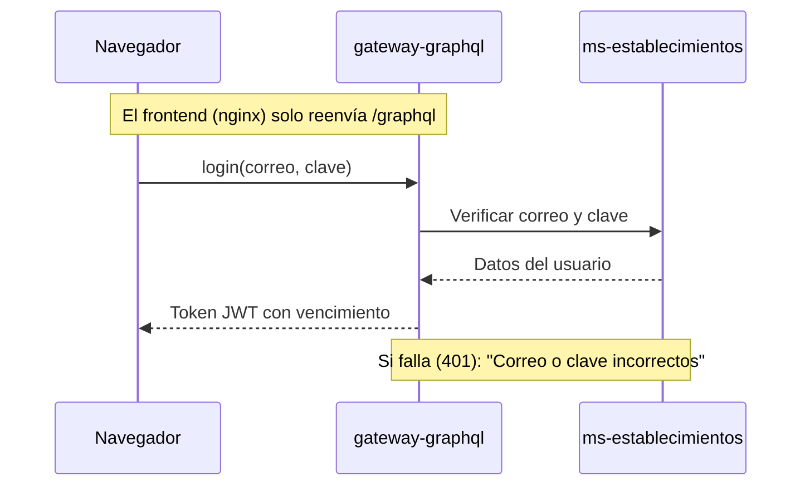
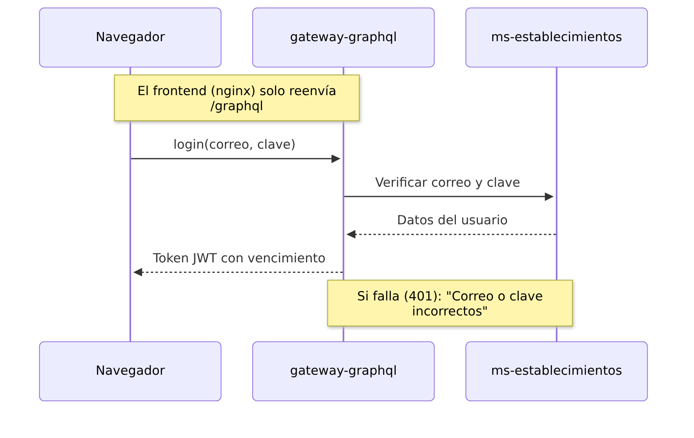
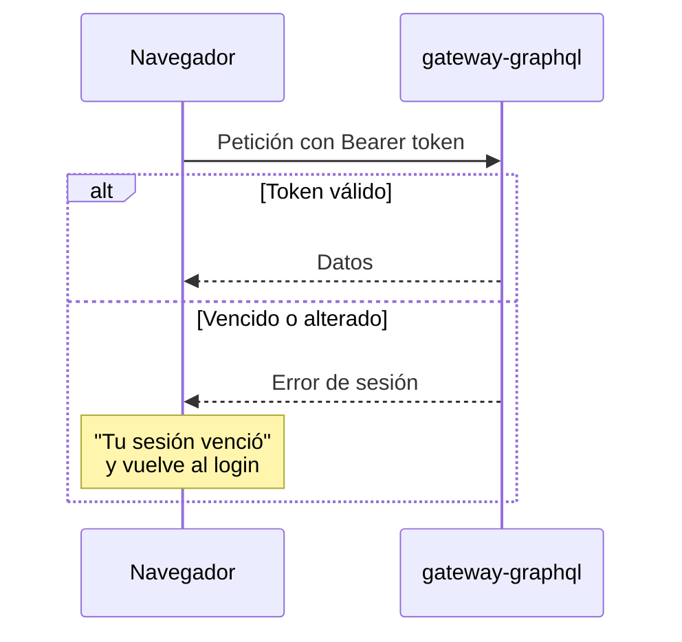
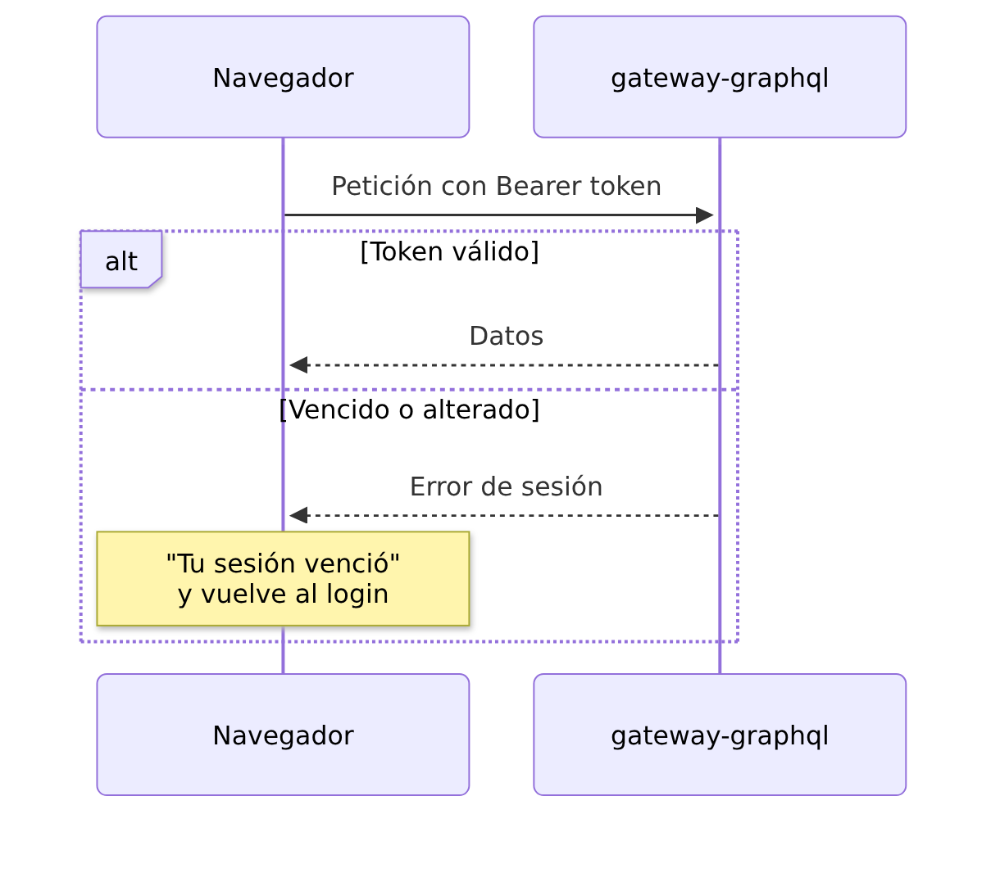

# 3. Flujo de login

## 3a. Iniciar sesión

| Paso | Mensaje del diagrama | Detalle técnico | Fuente |
|---|---|---|---|
| 1 | `login(correo, clave)` | Mutación GraphQL pública; llega por `POST /graphql` (nginx del frontend solo la reenvía al gateway) | `schema.graphqls`, `frontend/nginx.conf` |
| 2 | Verificar correo y clave | `POST /auth/verificar` con `{correo, clave}` | `AutenticacionController.java`, `AuthController.java` |
| 3 | Datos del usuario | usuarioId, nombre, establecimientoId, rol | record `UsuarioVerificado` |
| 4 | Token JWT con vencimiento | JWT HS256 firmado por el gateway; claims `sub`, `est`, `nom`, `rol`, `exp`; respuesta `SesionNegocio` (token, expiraEn, nombre, establecimientoId, rol) | `EmisorJwt.java` |
| Error | «Correo o clave incorrectos» | ms-establecimientos responde 401 (o 400 si llegan vacías) y el gateway devuelve `NoAutenticado` | `AutenticacionController.java` |

## 3b. Usar el token

| Mensaje del diagrama | Detalle técnico | Fuente |
|---|---|---|
| Petición con Bearer token | Cabecera `Authorization: Bearer <token>` | `InterceptorSesion.java` |
| Token válido: datos | El interceptor deja la sesión en el contexto; cada operación decide con `Exigir` si la requiere | `InterceptorSesion.java`, `Exigir.java` |
| Vencido o alterado: error de sesión | El interceptor registra `vencida` o `invalida`; la operación protegida falla con `NoAutenticado` | `InterceptorSesion.java`, `EmisorJwt.validar` |
| «Tu sesión venció» y vuelta al login | El frontend cierra la sesión y muestra el aviso «Tu sesión venció. Inicia sesión de nuevo.» | `frontend/src/api/graphql.js`, `App.jsx` |

Operaciones que exigen sesión: `inventario`, `resumenIngresos`, `notificaciones`, `clientesInactivos`, `cerrarCita`, y `cancelarCita` salvo cuando `canceladaPor` es `"cliente"` (`ConsultasController.java`). Una consulta pública con token vencido sigue funcionando: el interceptor nunca rechaza la petición.
