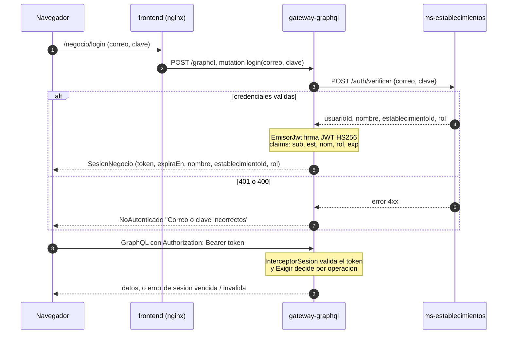
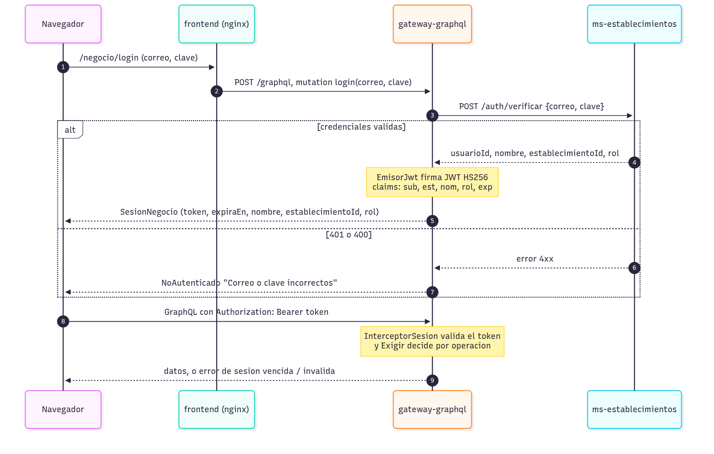

# 3. Flujo de login

## Verificado contra

| Elemento | Dónde se comprobó |
|---|---|
| Mutación pública `login(correo, clave)` | `schema.graphqls` y `AutenticacionController.java` |
| `POST /auth/verificar` en ms-establecimientos | `AuthController.java` (`/auth` + `/verificar`) y la llamada del gateway |
| Respuesta: usuarioId, nombre, establecimientoId, rol | record `UsuarioVerificado` |
| 4xx -> «Correo o clave incorrectos» | `AutenticacionController.java` |
| JWT HS256 emitido por el gateway; claims `sub`, `est`, `nom`, `rol`, `exp`; secreto >= 32 caracteres | `EmisorJwt.java` |
| Lectura de `Authorization: Bearer`; nunca rechaza, decide cada operación | `InterceptorSesion.java` |
| Exigen sesión: `inventario`, `resumenIngresos`, `notificaciones`, `clientesInactivos`, `cerrarCita`, y `cancelarCita` salvo `canceladaPor = "cliente"` | `Exigir.*` en `ConsultasController.java` |
