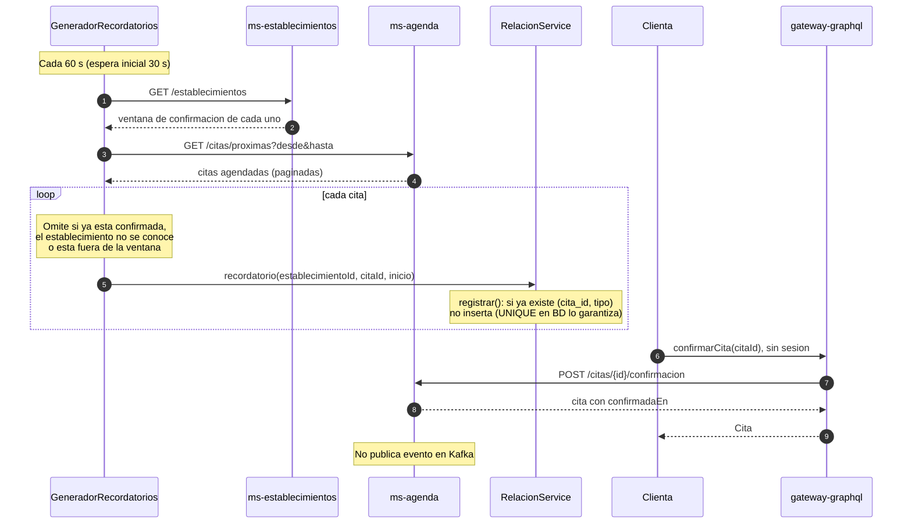
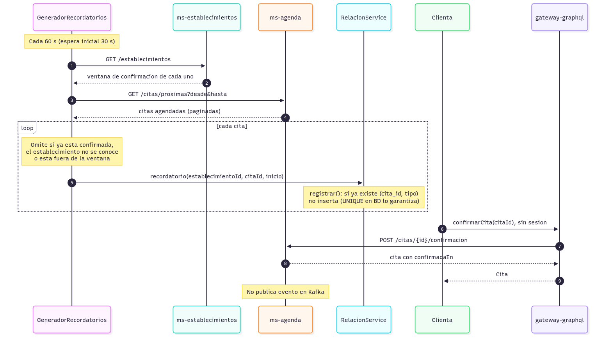

# 4. Flujo de recordatorio y confirmación

## Verificado contra

| Elemento | Dónde se comprobó |
|---|---|
| Job `GeneradorRecordatorios`, `@Scheduled` fixedDelay 60000 ms, espera inicial 30000 ms, activo por defecto (`RECORDATORIOS_ACTIVO:true`) | `GeneradorRecordatorios.java`, `application.properties` de ms-relacion-cliente |
| `GET /establecimientos` para la ventana de confirmación de cada uno | `EstablecimientosClient.java` |
| `GET /citas/proximas?desde&hasta&page&size` | `AgendaClient.java` y `CitaController.java` de ms-agenda |
| Se omite si ya está confirmada, sin establecimiento conocido o fuera de la ventana | `GeneradorRecordatorios.revisar()` |
| `recordatorio()` llama a `registrar()`, que consulta `existsByCitaIdAndTipo`; tipo `recordatorio-cita` | `RelacionService.java` |
| `UNIQUE (cita_id, tipo)` (`notificacion_unica`); `DataIntegrityViolationException` se trata como ya registrada | `Notificacion.java`, `GeneradorRecordatorios.java` |
| `confirmarCita` no exige sesión | `ConsultasController.confirmarCita` (sin `Exigir`) |
| `POST /citas/{id}/confirmacion`; `confirmar()` es idempotente y no llama a `publicar()` | `CitaController.java`, `CitaService.confirmar` |

Nota: el comentario de `GeneradorRecordatorios.java` dice «Por defecto está apagado», pero `application.properties` lo deja encendido. El diagrama sigue el valor real. El comentario no se modificó.
