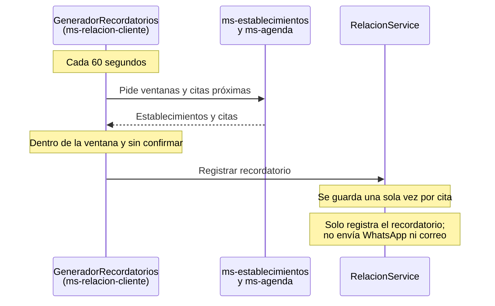
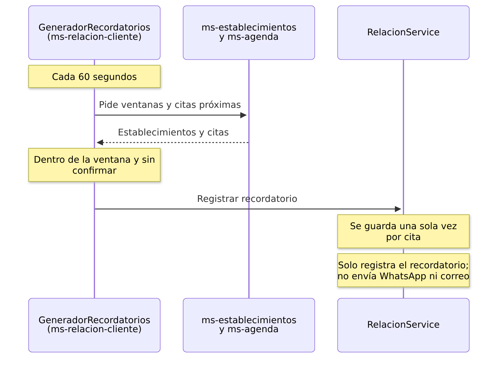
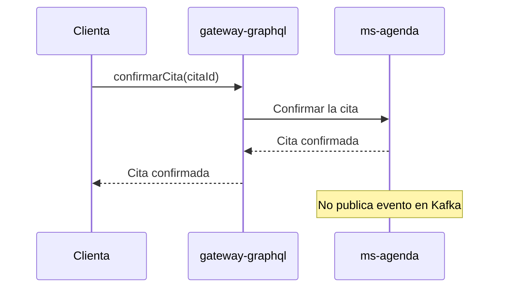
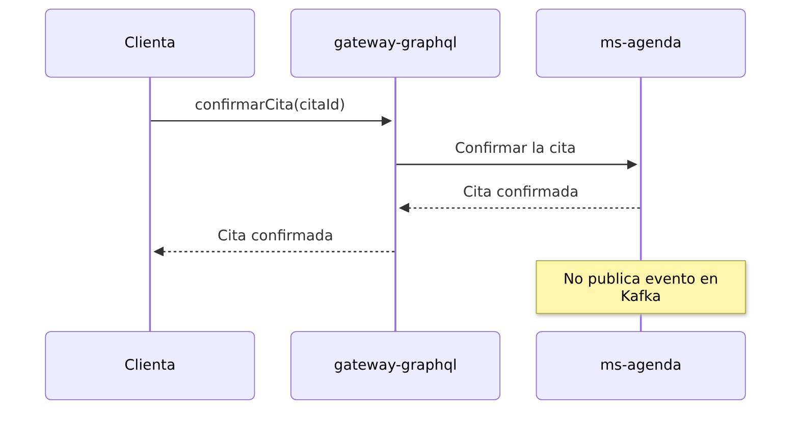

# 4. Recordatorio y confirmación

## 4a. Recordatorio automático

Regla: dentro de la ventana y sin confirmar, registra el recordatorio, una sola vez.

| Mensaje del diagrama | Detalle técnico | Fuente |
|---|---|---|
| Cada 60 segundos | `@Scheduled` fixedDelay 60000 ms, espera inicial 30000 ms; activo por defecto (`RECORDATORIOS_ACTIVO:true`) | `GeneradorRecordatorios.java`, `application.properties` de ms-relacion-cliente |
| Pide ventanas y citas próximas | «ms-establecimientos y ms-agenda» agrupa los dos servicios consultados: `GET /establecimientos` (ventana de confirmación de cada uno, en ms-establecimientos) y `GET /citas/proximas?desde&hasta` (ms-agenda, paginada) | `EstablecimientosClient.java`, `AgendaClient.java`, `CitaController.java` |
| Dentro de la ventana y sin confirmar | `ahora < inicio <= ahora + ventana` y `confirmadaEn` vacío; se omiten las confirmadas, las de establecimientos desconocidos y las fuera de ventana | `GeneradorRecordatorios.revisar()` |
| Registrar recordatorio | `RelacionService.recordatorio()` llama a `registrar()`, tipo `recordatorio-cita` | `RelacionService.java` |
| Solo registra el recordatorio; no envía WhatsApp ni correo | No hay envío real: la notificación solo se guarda; el comentario de `Notificacion.java` indica que el canal real (WhatsApp Business API) exige una cuenta aprobada | `Notificacion.java` |
| Se guarda una sola vez por cita | `existsByCitaIdAndTipo` y restricción `UNIQUE (cita_id, tipo)`; `DataIntegrityViolationException` se trata como ya registrada | `RelacionService.java`, `Notificacion.java` |

## 4b. Confirmación de la clienta

| Mensaje del diagrama | Detalle técnico | Fuente |
|---|---|---|
| `confirmarCita(citaId)` | Mutación GraphQL pública, sin sesión | `ConsultasController.confirmarCita` (sin `Exigir`) |
| Confirmar la cita | `POST /citas/{id}/confirmacion` en ms-agenda; es idempotente | `CitaController.java`, `CitaService.confirmar` |
| Cita confirmada | Devuelve la cita con `confirmadaEn` | `CitaResponse` |
| No publica evento en Kafka | `confirmar()` no llama a `publicar()` | `CitaService.java` |

Nota: el comentario de `GeneradorRecordatorios.java` dice «Por defecto está apagado», pero `application.properties` lo deja encendido. El diagrama sigue el valor real y el comentario no se modificó.
